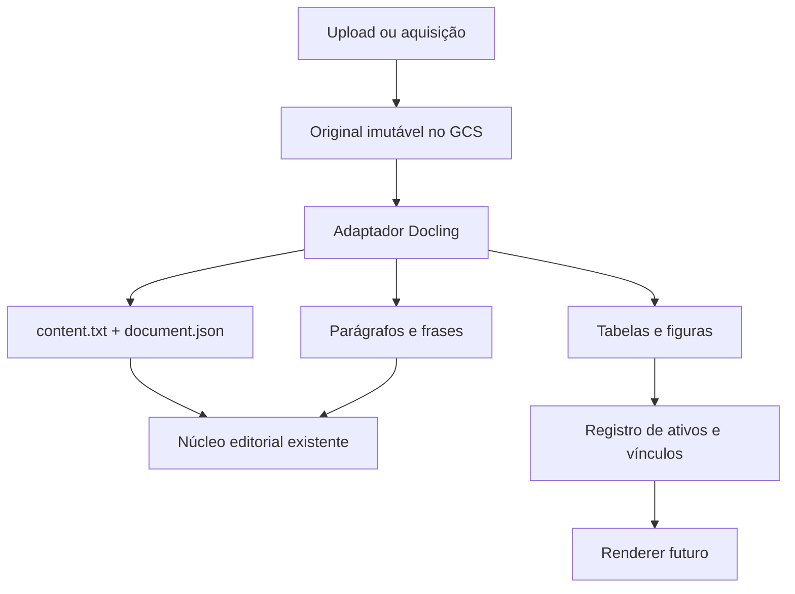
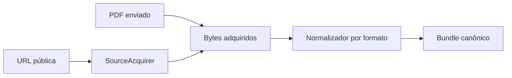

# Plano de integração do Docling no Hefesto

Status: implementação em andamento conforme este plano.

## 1. Resultado pretendido

O Docling será o normalizador de documentos na borda de entrada do Hefesto. Ele não substituirá aquisição, seleção editorial, digestão, Projeto Editorial nem redação. Sua responsabilidade termina quando uma fonte adquirida foi convertida em:

1. texto canônico legível;
2. parágrafos e frases endereçáveis;
3. tabelas, figuras e gráficos preservados como ativos;
4. proveniência mínima suficiente para reencontrar cada elemento no original;
5. um recibo operacional que diga objetivamente o que foi ou não extraído.

O núcleo editorial congelado continuará recebendo `PlanningRequest.sources` e trabalhando com parágrafos, frases e passagens. A mudança acontece antes dele, no adaptador de digestão.



## 2. Decisões tomadas

- A primeira entrega aceita PDF, DOCX, PPTX, XLSX, HTML/XHTML, EPUB, Markdown, TXT, imagens, áudio e vídeo. Todos convergem para o mesmo contrato canônico; TXT usa preservação textual direta e mídia usa ASR local.
- O Docling roda **como biblioteca dentro do Cloud Run Job existente**. Não haverá `docling-serve`, Redis nem um segundo serviço nesta fase.
- A execução inicial será **CPU-only**, sem GPU e sem chamadas remotas de IA.
- A ingestão não fará chamadas de LLM. Relações entre texto, tabela e figura serão derivadas da estrutura, ordem de leitura e proveniência do documento.
- O `content.txt` é a representação humana canônica. Ele não é a única representação da fonte nem será reanalisado para reconstruir a estrutura.
- O `DoclingDocument` será percorrido uma vez. Dessa mesma travessia saem o texto, as linhas relacionais, os ativos e seus vínculos.
- O JSON lossless do `DoclingDocument` será preservado no GCS como artefato interno de recuperação e depuração, não como coração do produto.
- PostgreSQL continuará guardando estrutura e endereços; GCS guardará bytes grandes e artefatos.
- Tabelas não serão reduzidas apenas a Markdown ou texto. Estruturas com `rowspan`/`colspan` precisam de uma forma lossless.
- Figuras e tabelas serão vinculadas a parágrafos por uma relação muitos-para-muitos, embora cada ativo tenha um ponto de ancoragem primário.
- Descrição de imagens por VLM, classificação editorial de figuras e interpretação semântica de gráficos ficam fora da primeira entrega.
- O `pypdf` deixa de ser normalizador depois da aceitação do novo caminho. Não serão mantidos dois normalizadores permanentes.

## 3. Por que essa divisão é tecnicamente correta

O `DoclingDocument` já diferencia texto, tabelas, figuras, corpo e elementos de mobiliário, como cabeçalhos e rodapés. Também preserva hierarquia, ordem de leitura, caixas delimitadoras e proveniência quando o formato oferece esses dados. Achatar tudo em TXT e depois tentar redescobrir parágrafos, tabelas e posições jogaria fora exatamente a informação pela qual estamos adotando o Docling.

Ao mesmo tempo, usar somente o JSON do Docling como dado do produto acoplaria o Hefesto a um contrato externo grande e mutável. O adaptador deve, portanto, traduzir o `DoclingDocument` para um contrato pequeno e próprio, preservando o JSON original fora do banco para reprocessamento ou inspeção.

## 4. Estado atual do Hefesto

### 4.1 Caminho vigente

1. O navegador aceita apenas PDF e permite arquivos de até 1 GB.
2. A API registra e envia o upload para o GCS.
3. A ingestão, porém, rejeita fontes acima de 200 MB.
4. PDFs enviados pelo usuário passam por `pypdf` em `normalization.py`.
5. O texto é limpo e dividido por linhas em branco.
6. `segmentation.py` volta a dividir o texto em parágrafos e frases.
7. `save_structure()` grava parágrafos e frases no PostgreSQL.
8. Fontes adquiridas por URL entram por outro caminho e frequentemente chegam como Markdown/texto já normalizado pelo adquiridor.

### 4.2 Limitações objetivas

- A interface promete 1 GB, mas a ingestão suporta 200 MB.
- PDFs escaneados falham porque não existe OCR.
- Colunas, caixas laterais, legendas e ordem de leitura dependem do resultado plano do `pypdf`.
- Tabelas viram texto sem estrutura confiável.
- Figuras e gráficos desaparecem.
- Parágrafos não guardam página, caixa delimitadora, tipo de elemento nem offsets no texto canônico.
- O caminho de PDF enviado e o caminho de PDF adquirido não usam a mesma normalização.
- Uma falha local de normalização pode interromper o conjunto em vez de isolar somente a fonte defeituosa.

## 5. Contrato canônico de saída

Cada fonte normalizada deve produzir um `NormalizedDocumentBundle` interno. Esse nome é do Hefesto; não deve expor classes do Docling ao restante do sistema.

```python
class NormalizedDocumentBundle:
    source: NormalizedSource
    paragraphs: list[Paragraph]
    assets: list[SourceAsset]
    asset_links: list[ParagraphAssetLink]
    receipt: DocumentNormalizationReceipt
```

### 5.1 Artefatos por fonte no GCS

```text
hefesto-product/projects/{project_id}/sources/{source_id}/
├── original.pdf
├── canonical/content.txt
├── canonical/document.json
├── assets/
│   ├── {asset_id}.png
│   └── {asset_id}.html ou {asset_id}.csv
└── normalization-receipt.json
```

- `original.pdf`: bytes recebidos, imutáveis.
- `content.txt`: texto editorialmente legível, em ordem de leitura, sem cabeçalhos/rodapés repetitivos.
- `document.json`: serialização lossless do `DoclingDocument`, versionada pelo recibo.
- `assets/*.png`: recorte visual de figura ou tabela quando disponível.
- `assets/*.html`: estrutura de tabela preservando células mescladas. CSV pode ser adicionado quando a tabela é retangular e não perde semântica.
- `normalization-receipt.json`: versões, configuração, estado, duração, confiança e contagens.

### 5.2 Texto canônico

O `content.txt` será construído diretamente da ordem de leitura do corpo do documento:

- um bloco textual por parágrafo lógico;
- blocos separados por uma linha em branco;
- listas mantêm marcadores legíveis;
- títulos permanecem como texto, com `element_type` registrado no parágrafo;
- cabeçalhos, rodapés e numeração de página classificados como `furniture` não entram no texto principal;
- tabelas recebem uma representação textual acessível no ponto em que aparecem;
- figuras recebem uma linha estável `[asset:<asset_id>]` no ponto em que aparecem;
- legendas permanecem no texto e são relacionadas ao ativo correspondente;
- hifenização meramente visual não deve virar conteúdo;
- nenhuma reescrita, resumo, tradução ou “limpeza editorial” é permitida nesta fase.

Os offsets `canonical_start` e `canonical_end` de cada parágrafo referem-se a esse arquivo. O banco e o TXT são, portanto, duas vistas da mesma travessia, não uma transformação em cascata.

### 5.3 Parágrafo

O contrato atual de `Paragraph` será ampliado sem mudar seu papel editorial:

| Campo | Finalidade |
|---|---|
| `paragraph_id` | identidade determinística já usada pelo núcleo |
| `source_id`, `source_ordinal`, `ordinal` | endereço já existente |
| `text`, `sentences` | conteúdo já existente |
| `element_type` | `title`, `section_header`, `paragraph`, `list_item`, `caption`, `formula` ou equivalente próprio |
| `page_no` | primeira página de origem, quando houver |
| `bbox` | caixa delimitadora normalizada ou nula |
| `canonical_start`, `canonical_end` | offsets no `content.txt` |
| `origin_refs` | referências internas aos itens do Docling que contribuíram para o bloco |

`origin_refs` pertence ao payload JSON do parágrafo. Não é necessário criar colunas SQL para cada detalhe de proveniência na primeira migração.

### 5.4 Frase

A segmentação de frases do Hefesto permanece depois que o Docling definiu o parágrafo lógico. O Docling não precisa substituir esse contrato. A frase herda o endereço do parágrafo; offsets locais podem ser adicionados ao payload somente se um consumidor real passar a precisar deles.

### 5.5 Ativo de fonte

```python
class SourceAsset:
    asset_id: Sha256
    source_id: UUID
    source_ordinal: int
    ordinal: int
    kind: Literal["table", "figure", "chart", "unknown_picture"]
    role: Literal["content", "decorative", "unknown"]
    page_no: int | None
    bbox: BoundingBox | None
    caption: str | None
    text_representation: str | None
    blob_uri: str | None
    structured_uri: str | None
    binary_sha256: Sha256 | None
    origin_ref: str
    payload: dict[str, object]
```

Regras:

- `asset_id` é determinístico sobre `source_id`, referência estrutural, tipo e hash do conteúdo extraído.
- `kind` descreve o que foi tecnicamente extraído; `role` evita confundir detecção técnica com relevância editorial.
- Na primeira entrega, `chart` só será usado quando o próprio Docling o identificar com segurança sem descrição por VLM; caso contrário, será `figure` ou `unknown_picture`.
- Logos, ícones e decoração podem ser marcados como `decorative` somente por sinal estrutural ou classificação local suficientemente explícita. Na dúvida, `unknown`; não apagar silenciosamente.
- A decisão posterior de usar ou não um ativo no produto final pertence ao Hefesto/renderer, não ao normalizador.

### 5.6 Vínculo ativo–parágrafo

```python
class ParagraphAssetLink:
    paragraph_id: Sha256
    asset_id: Sha256
    relation: Literal[
        "anchor_after",
        "anchor_before",
        "caption",
        "context_before",
        "context_after",
    ]
    distance: int
    primary: bool
```

Algoritmo determinístico, sem LLM:

1. preservar a relação explícita entre legenda e figura/tabela quando o documento a fornecer;
2. localizar o ativo na ordem de leitura do corpo;
3. usar como âncora primária o parágrafo textual imediatamente anterior na mesma seção;
4. se não existir anterior, usar o primeiro posterior na mesma seção;
5. registrar a legenda e o parágrafo posterior próximo como vínculos adicionais quando existirem;
6. nunca vincular ao cabeçalho/rodapé apenas por proximidade geométrica;
7. registrar o motivo e a distância, permitindo revisão futura sem repetir a conversão.

Esse desenho permite que uma figura sustente mais de um parágrafo e que um parágrafo tenha mais de um ativo, sem obrigar inteligência editorial no momento da ingestão.

## 6. Persistência relacional

### 6.1 Alterações em tabelas existentes

- `hefesto_product.paragraphs` continua com as colunas atuais.
- O payload passa a conter `element_type`, página, caixa, offsets e referências de origem.
- `hefesto_product.sentences` permanece inalterada na primeira entrega.

### 6.2 Novas tabelas

`source_assets`:

```sql
CREATE TABLE hefesto_product.source_assets (
    execution_run_id uuid NOT NULL,
    asset_id char(64) NOT NULL,
    source_id uuid NOT NULL,
    source_ordinal integer NOT NULL,
    asset_ordinal integer NOT NULL,
    kind text NOT NULL,
    role text NOT NULL,
    page_no integer,
    caption text,
    text_representation text,
    blob_uri text,
    structured_uri text,
    binary_sha256 char(64),
    payload jsonb NOT NULL,
    PRIMARY KEY (execution_run_id, asset_id),
    UNIQUE (execution_run_id, source_ordinal, asset_ordinal)
);
```

`paragraph_assets`:

```sql
CREATE TABLE hefesto_product.paragraph_assets (
    execution_run_id uuid NOT NULL,
    paragraph_id char(64) NOT NULL,
    asset_id char(64) NOT NULL,
    relation text NOT NULL,
    distance integer NOT NULL,
    is_primary boolean NOT NULL,
    payload jsonb NOT NULL,
    PRIMARY KEY (execution_run_id, paragraph_id, asset_id, relation),
    FOREIGN KEY (execution_run_id, paragraph_id)
        REFERENCES hefesto_product.paragraphs(execution_run_id, paragraph_id),
    FOREIGN KEY (execution_run_id, asset_id)
        REFERENCES hefesto_product.source_assets(execution_run_id, asset_id)
);
```

Índices necessários: ativos por fonte, vínculos por parágrafo e vínculos por ativo. A migração também deve incluir as novas tabelas na limpeza operacional de `maintenance.py`, na ordem correta de dependências.

### 6.3 Ordem transacional

1. persistir os artefatos imutáveis no GCS;
2. criar/atualizar o run;
3. gravar parágrafos e frases;
4. gravar ativos;
5. gravar vínculos;
6. registrar o recibo da etapa.

Reexecuções devem produzir os mesmos IDs e `ON CONFLICT DO NOTHING` só pode ser usado depois de validar que o conteúdo em conflito é idêntico. Conflito com conteúdo diferente é erro de determinismo, não sucesso.

## 7. Adaptador Docling

Criar um módulo isolado, por exemplo `hefesto/document_normalization.py`, com uma interface própria:

```python
class DocumentNormalizer(Protocol):
    def normalize(self, request: DocumentNormalizationRequest) -> NormalizedDocumentBundle: ...
```

A implementação `DoclingPdfNormalizer` fará:

1. validar assinatura PDF, tamanho e nome seguro;
2. entregar bytes ao `DocumentConverter` por `DocumentStream`;
3. executar o pipeline PDF padrão configurado;
4. validar `ConversionStatus` e erros;
5. exportar JSON lossless;
6. percorrer `document.body` em ordem de leitura;
7. construir simultaneamente texto canônico, parágrafos e mapeamento de origem;
8. extrair tabelas e figuras;
9. calcular vínculos;
10. produzir recibo e devolver o bundle.

O `DocumentConverter` deve ser criado uma vez por processo do worker e reutilizado entre fontes. Modelos não devem ser carregados a cada arquivo.

### 7.1 Configuração inicial do pipeline PDF

| Opção | Primeira entrega | Motivo |
|---|---:|---|
| pipeline PDF padrão | sim | preserva layout, ordem de leitura e tabelas |
| `do_table_structure` | sim | tabelas são conteúdo, não decoração |
| `generate_picture_images` | sim | permite guardar figuras e gráficos |
| imagens/crops necessários para tabelas | sim | permite renderer e conferência futura |
| OCR | sim, quando a página exigir | PDFs escaneados não podem continuar falhando por definição |
| descrição de figuras por VLM | não | custo, latência e decisão semântica desnecessários na ingestão |
| serviços remotos | não | privacidade, previsibilidade e ausência de necessidade |
| plugins externos | não | superfície de execução desnecessária |
| enriquecimentos generativos | não | responsabilidade editorial é posterior |

Não usar `NativePdfPipeline` como caminho principal: a documentação informa que ele dispensa modelos de layout, OCR e tabela, exatamente as capacidades buscadas aqui.

### 7.2 OCR

OCR será parte do normalizador PDF, mas acionado conforme a necessidade detectada pelo pipeline, não como duas implementações paralelas do Hefesto.

- selecionar um único engine local suportado pelo Docling durante a implementação;
- configurar idiomas a partir do idioma declarado da fonte usando códigos aceitos pelo engine;
- manter fallback seguro para idioma desconhecido;
- registrar engine, versão, idiomas e páginas submetidas a OCR;
- não chamar OCR remoto;
- não rejeitar automaticamente um documento somente por confiança baixa; registrar o grau e permitir que o processo siga quando há conteúdo utilizável.

A escolha final entre EasyOCR, RapidOCR ou Tesseract deve ser feita por compatibilidade de imagem, dependências e idiomas do produto durante a implementação. Isso não é uma competição de ferramentas: é uma verificação única do engine que será empacotado.

### 7.3 Tabelas

Para cada `TableItem`:

1. preservar a posição e a legenda;
2. produzir uma representação textual acessível para `content.txt` e digestão;
3. salvar HTML ou JSON estruturado como forma canônica da tabela;
4. salvar CSV adicional somente quando não houver perda relevante por células mescladas;
5. salvar recorte PNG quando o backend permitir;
6. vincular ao parágrafo e à legenda;
7. manter no payload a grade, spans e referência Docling necessária para rastreio.

Markdown não será a estrutura canônica da tabela: a documentação do Docling declara que células mescladas são achatadas em Markdown, mas preservadas em JSON e HTML.

### 7.4 Figuras e gráficos

Para cada `PictureItem`:

1. extrair o recorte quando houver imagem de página/proveniência;
2. guardar PNG e hash;
3. preservar página, caixa, ordem e legenda;
4. inserir o marcador estável no texto canônico;
5. criar vínculos aos parágrafos de contexto;
6. classificar somente o que o pipeline local puder afirmar sem geração;
7. deixar conteúdo sem classificação como `unknown_picture`.

O normalizador não precisa “entender o gráfico”. Ele precisa impedir que o gráfico desapareça e entregar ao estágio posterior o gráfico, sua legenda, origem e contexto.

## 8. Unificação dos caminhos de entrada

Aquisição e normalização são responsabilidades diferentes:



- Um PDF enviado e um PDF obtido da internet devem atravessar o mesmo `DoclingPdfNormalizer`.
- O `SourceAcquirer` continua responsável por conseguir bytes públicos e declarar falha quando não consegue.
- Quando uma aquisição retorna HTML/Markdown, o primeiro rollout pode continuar usando o normalizador textual atual. A expansão do Docling para HTML vem depois do PDF.
- `normalized_text` produzido por rotas de aquisição não deve substituir a normalização Docling quando os bytes adquiridos são realmente PDF.
- O normalizador nunca faz download de URL; recebe bytes já adquiridos. Isso mantém SSRF, redirecionamentos e credenciais fora do Docling.

## 9. Falhas, confiança e limites

### 9.1 Estado por fonte

Cada fonte termina em um destes estados próprios do Hefesto:

- `normalized`: estrutura utilizável e conversão concluída;
- `partial`: estrutura utilizável, mas Docling reportou erros ou páginas incompletas;
- `failed`: nenhum conteúdo utilizável.

Uma fonte `failed` não derruba as demais. A ingestão global só falha quando nenhuma fonte utilizável restar. `partial` fica explícito no recibo; não é transformado silenciosamente em sucesso pleno.

Os graus de confiança `poor`, `fair`, `good` e `excellent` serão registrados. Não haverá corte automático por valor numérico, porque a própria documentação recomenda orientar decisões pelos graus e trata os números internos como sujeitos a mudança.

### 9.2 Limites coerentes

- Harmonizar navegador, API, banco e worker no mesmo limite inicial de **200 MB por fonte**, que é o limite real já aplicado pela ingestão.
- O limite de páginas e o timeout serão configurações explícitas do Job, não constantes escondidas.
- Começar com `document_timeout=120s`, recomendação operacional documentada pelo Docling, e registrar `partial` quando houver conteúdo parcial. Alterar esse valor depois exige evidência de PDFs reais, não tentativa cega.
- O limite de 64 fontes por projeto permanece.
- Conversões Docling rodam com concorrência 1 por task na primeira entrega para conter memória; aquisição pode continuar independente.
- `OMP_NUM_THREADS` deve corresponder aos 4 CPUs já alocados ao Job, sem oversubscription.

## 10. Empacotamento e execução

### 10.1 Dependências

- adicionar `docling` com versão exata validada e fixada;
- usar wheel CPU-only do PyTorch compatível com Python 3.12;
- fixar as dependências transitivas críticas no artefato de build ou lockfile;
- remover `pypdf` depois do período curto de ativação controlada;
- registrar versões de Docling, `docling-core`, pipeline e modelos no recibo.

O número exato da versão não deve ser inventado neste documento: ele será o release estável instalado e validado no commit de implementação, então ficará imutável no build.

### 10.2 Imagem Docker

O build deve baixar os modelos necessários, não a execução em produção. O container do Job precisa iniciar sem depender de download público.

Passos esperados:

1. instalar bibliotecas de sistema estritamente necessárias;
2. instalar dependências Python CPU-only;
3. baixar/copiar artefatos dos modelos para diretório conhecido;
4. configurar `artifacts_path` do pipeline para esse diretório;
5. executar um smoke local de import e construção do converter durante CI;
6. manter usuário não root;
7. verificar tamanho e tempo de startup da imagem.

A API usa hoje a mesma imagem do Job, com 1 GiB. Para não carregar modelos na API, nenhum objeto Docling pode ser importado ou inicializado no startup do módulo web. A importação deve ser tardia e usada apenas no comando do worker. Se o tamanho ou as vulnerabilidades da imagem se tornarem problemáticos, separar imagens API/Job é uma otimização posterior, não pré-requisito.

### 10.3 Cloud Run Job

O Job já possui 4 CPU, 8 GiB e timeout de 7200 s, configuração compatível com a primeira implantação CPU-only. O plano não pede infraestrutura nova. Métricas mínimas por fonte:

- tempo de conversão;
- páginas;
- páginas com OCR;
- caracteres, parágrafos e frases;
- tabelas e figuras;
- bytes de ativos;
- status, erros e confiança;
- pico de memória, se disponível pela plataforma.

## 11. Mudanças por arquivo

| Área | Mudança planejada |
|---|---|
| `pyproject.toml` | adicionar Docling/CPU runtime fixados; remover `pypdf` no corte final |
| `Dockerfile` | empacotar dependências e modelos; impedir downloads em runtime |
| `contracts.py` | provenance de parágrafo, `SourceAsset`, `ParagraphAssetLink`, recibo e bundle |
| `document_normalization.py` | interface e implementação Docling multiformato |
| `normalization.py` | manter apenas normalização textual adquirida; retirar PDF antigo no corte |
| `ingestion.py` | unificar documentos enviados/adquiridos, persistir bundle, isolar falha por fonte |
| `segmentation.py` | aceitar parágrafos estruturados sem voltar a parti-los por linhas em branco |
| `storage.py` | persistência imutável de texto, JSON e ativos |
| `postgres.py` | salvar ativos e vínculos junto da estrutura |
| `service.py` | preparar a estrutura já produzida pela ingestão sem resegmentar e perder provenance |
| `worker.py` | reutilizar converter por processo; registrar métricas e estados por fonte |
| `api.py` | harmonizar limite em 200 MB e validar a matriz de formatos |
| `app.js` | mostrar o mesmo limite real de 200 MB |
| migração nova | criar `source_assets` e `paragraph_assets` e seus índices |
| `maintenance.py` | inventário e exclusão das novas tabelas/objetos |
| testes | fixtures locais e provas estruturais sem LLM nem rede |
| documentação | atualizar arquitetura canônica após aceite |

## 12. Sequência de implementação

### Etapa 0 — contrato e feature flag curta

- criar os contratos próprios sem importar Docling fora do adaptador;
- criar migração relacional;
- adicionar `HEFESTO_DOCUMENT_NORMALIZER=docling_pdf` com valor antigo disponível apenas durante um deploy de segurança;
- definir recibo e caminhos GCS antes da lógica de conversão.

Saída: esquema implantável e contratos revisáveis, sem alterar o núcleo.

### Etapa 1 — conversão PDF estruturada

- instalar e empacotar Docling CPU-only;
- implementar converter reutilizável;
- percorrer corpo em ordem de leitura;
- gerar `content.txt`, `document.json`, parágrafos e frases;
- preservar tipos, páginas, caixas e offsets;
- suportar OCR local quando necessário;
- tratar `SUCCESS`, `PARTIAL_SUCCESS` e falhas.

Saída: PDF textual, multicoluna e escaneado produz estrutura canônica sem LLM.

### Etapa 2 — tabelas e figuras

- extrair tabelas em forma textual, lossless e visual;
- extrair figuras;
- gerar IDs e marcadores;
- relacionar legendas e parágrafos;
- persistir ativos e vínculos.

Saída: nenhum ativo de conteúdo detectado desaparece no TXT/banco.

### Etapa 3 — integração com o fluxo real

- fazer `ingest()` e `ingest_acquired()` usarem o mesmo normalizador para PDF;
- impedir que `service.prepare()` resegmente o texto e descarte a estrutura;
- persistir estrutura/ativos antes da primeira chamada editorial;
- expor contagens e falhas no recibo existente;
- manter o núcleo editorial e prompts intactos.

Saída: projetos com fontes fornecidas e projetos de busca chegam ao mesmo núcleo.

### Etapa 4 — corte

- executar as provas locais e um único teste real orientado;
- ativar Docling no Job;
- confirmar recibo e artefatos no projeto de teste;
- remover o caminho PDF de `pypdf` e a flag de rollback no commit imediatamente posterior ao aceite;
- atualizar `product-architecture.md`.

Saída: um normalizador PDF, sem arquitetura dupla permanente.

### Etapa 5 — formatos futuros, separadamente

Depois que PDF estiver aceito:

1. DOCX/PPTX/XLSX e formatos OpenDocument;
2. HTML/EPUB/Markdown quando trouxerem benefício sobre o caminho textual atual;
3. imagens avulsas;
4. áudio e vídeo apenas com requisito de produto explícito.

Cada expansão adiciona MIME types e fixtures, mas reutiliza o mesmo bundle. Não exige mudar o núcleo editorial.

## 13. Validação sem gasto editorial

Toda a validação técnica usa fixtures locais e zero chamadas pagas de LLM, busca ou aquisição externa.

### 13.1 Conjunto mínimo fixo

- PDF digital simples com títulos, parágrafos e lista;
- PDF de duas colunas;
- PDF com tabela simples;
- PDF com células mescladas;
- PDF com figura, gráfico e legendas;
- PDF escaneado curto em português;
- PDF misto, com páginas digitais e escaneadas;
- PDF criptografado;
- arquivo inválido com extensão PDF;
- duas fontes juntas, uma válida e uma defeituosa.

Fixtures devem ser pequenas, livres para uso e armazenadas no repositório ou geradas determinística e localmente.

### 13.2 Provas automatizadas

- ordem de leitura esperada;
- texto canônico estável;
- IDs determinísticos em duas execuções;
- offsets que recompõem exatamente o texto do parágrafo;
- frases subordinadas ao parágrafo correto;
- tabela com spans preservados no artefato estruturado;
- marcadores com ativo correspondente;
- todo ativo com origem, página/caixa quando disponíveis e âncora primária;
- GCS imutável não aceita conteúdo divergente no mesmo nome;
- PostgreSQL idempotente não mascara divergência;
- uma fonte ruim não elimina uma boa;
- nenhuma conexão remota durante conversão;
- nenhum carregamento do Docling no processo da API;
- recibo informa `partial` e erros reais;
- limpeza operacional inclui novos registros e blobs.

### 13.3 Um teste real de aceite

Depois dos testes locais, executar uma única rodada completa pela interface com um projeto representativo. Conferir:

1. fontes recebidas e seus estados;
2. texto canônico;
3. parágrafos/páginas;
4. tabelas e figuras encontradas;
5. vínculos visíveis no recibo técnico;
6. Projeto Editorial e texto final sem regressão.

Isso testa a integração do Hefesto; não compara ferramentas nem multiplica experimentos.

## 14. Critérios de aceite

A integração está pronta quando todos forem verdadeiros:

- PDF enviado e PDF adquirido usam o mesmo normalizador.
- O original é preservado antes da conversão.
- `content.txt` é legível e respeita a ordem lógica do documento.
- Parágrafos chegam ao núcleo sem uma segunda segmentação destrutiva.
- Cada parágrafo estruturado possui endereço determinístico e provenance disponível.
- Cada tabela detectada possui texto para digestão e estrutura lossless para reutilização.
- Cada figura detectada possui arquivo ou falha explícita, legenda quando existente e vínculo a parágrafo.
- Todo marcador `[asset:...]` resolve para um ativo persistido.
- Uma fonte defeituosa não aborta outras fontes utilizáveis.
- PDFs escaneados entram pelo OCR local, sem serviço externo.
- A conversão não chama LLM e não baixa modelos em runtime.
- Recibos mostram versões, configuração, duração, contagens, confiança e erros.
- Reexecução da mesma entrada é idempotente.
- O núcleo editorial congelado e seus prompts não são alterados para acomodar Docling.
- O limite anunciado e o limite executado são iguais.
- O caminho antigo de PDF é removido após o aceite.

## 15. Riscos e contenções

| Risco | Contenção |
|---|---|
| imagem Docker cresce muito | CPU-only, formatos opcionais não instalados, modelos estritamente necessários |
| startup do Job fica lento | modelos no build e converter singleton por processo |
| API de 1 GiB herda dependências pesadas | import tardio; separar imagens somente se a medição exigir |
| OCR aumenta tempo e memória | acionamento por necessidade, concorrência 1, timeout e métricas por página |
| Docling muda contrato | versão exata, adaptador próprio e JSON/versões no recibo |
| tabela perde spans | HTML/JSON lossless, nunca apenas Markdown/CSV |
| figura decorativa polui o fluxo | `role`, corpo versus furniture e estado `unknown`, sem descarte agressivo |
| vínculo figura–parágrafo imperfeito | regra determinística registrável e relação muitos-para-muitos; inteligência editorial posterior |
| fonte parcial parece íntegra | estado `partial`, erros e confiança no recibo |
| reprocessamento caro após bug | original e `document.json` imutáveis permitem refazer adaptação sem nova aquisição |
| regressão no núcleo | fronteira `NormalizedDocumentBundle`; prompts e lógica editorial permanecem congelados |

## 16. Fora de escopo da primeira entrega

- escolher ativos para o texto final;
- descrever semanticamente imagens com VLM;
- interpretar números de gráficos;
- gerar alt text editorial definitivo;
- deduplicar figuras semanticamente entre fontes;
- suportar formatos legados e especializados fora da matriz do produto (DOC/XLS/PPT, OpenDocument, XMLs específicos, e-mail, Apple Pages, BoxNote e AFP);
- transformar o Docling em serviço independente;
- chunking/RAG do Docling;
- substituir a seleção e digestão editorial do Hefesto;
- redesenhar o renderer ou decidir créditos finais.

## 17. Documentação oficial consultada

- [Arquitetura do Docling](https://docling-project.github.io/docling/concepts/architecture/)
- [Modelo `DoclingDocument`](https://docling-project.github.io/docling/concepts/docling_document/)
- [Serialização e preservação de tabelas](https://docling-project.github.io/docling/concepts/serialization/)
- [Formatos de entrada e saída](https://docling-project.github.io/docling/usage/supported_formats/)
- [Opções de pipeline](https://docling-project.github.io/docling/reference/pipeline_options/)
- [Opções avançadas e pipelines PDF](https://docling-project.github.io/docling/usage/advanced_options/)
- [OCR no Docling](https://docling-project.github.io/docling/concepts/OCR/)
- [Confiança da conversão](https://docling-project.github.io/docling/concepts/confidence_scores/)
- [Conversor, limites e resultados](https://docling-project.github.io/docling/reference/document_converter/)
- [Exemplo oficial de exportação de figuras](https://docling-project.github.io/docling/_generated/examples/export_figures/)
- [Exemplo oficial de exportação de tabelas](https://docling-project.github.io/docling/_generated/examples/export_tables/)
- [Processamento de áudio e vídeo](https://docling-project.github.io/docling/usage/processing_audio_media/)

## 18. Definição de pronto para começar a codificar

Não resta decisão arquitetural bloqueante para a primeira entrega. As escolhas técnicas iniciais foram materializadas assim:

1. Docling `2.129.0`, release estável disponível, fixado no build CPU;
2. Tesseract CLI local, com os pacotes de idioma Debian disponíveis na imagem;
3. tabela em HTML mais o JSON lossless completo do `DoclingDocument`;
4. modelos Docling de layout e TableFormer e Whisper Small embutidos na imagem.

Qualquer alteração dessas escolhas exige incompatibilidade reproduzível ou necessidade real do produto.
